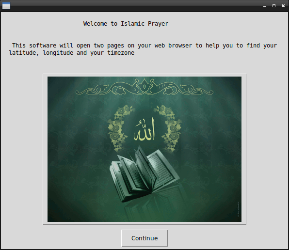

# Islamic Prayer — Tkinter Desktop Calculator

Developer of this application: Hamdy Abou El Anein
Contact: hamdy.aea@protonmail.com
Repository license: GNU GPL v3 (see LICENSE).

The desktop interface has been rewritten from EasyGUI to **Tkinter/ttk**,
which is included with most Python 3 desktop installations.



## Features

- Latitude, longitude and manual UTC offset with input validation.
- Five historical Fajr/Isha calculation presets and two Asr schools.
- Select an ISO date, then calculate Fajr, sunrise, Dhuhr, Asr, Maghrib,
  Isha and Qiblah direction.
- Opens OpenStreetMap for finding coordinates **only when requested**.
- No credentials, telemetry, external API calls or network dependency.
- Clear input errors instead of unhandled crashes or EasyGUI cancellation.

## Run

```sh
python3 islamic-prayer.py
```

Requires Python 3 with Tkinter. No pip packages are needed. On Linux,
install your distribution's `tk` package if Tkinter is unavailable.

## Verification

```sh
python3 -m unittest discover -s tests -v
```

Tests validate input handling and regression values for a fixed date.
The application was also opened, calculated, and closed on a real Manjaro
desktop during the modernization.

## Accuracy and attribution

**Important:** This is an educational astronomical calculator, not an
authoritative religious timetable. Prayer times depend on the calculation
method, geographic location, UTC offset, local daylight-saving changes and
high-latitude rules. Check the results against your local mosque's timetable.

The original `pyIslam/` calculation implementation was retained
**without modification**; its mathematical accuracy and third-party
provenance were not independently certified in this modernization.
The developer attribution above refers to the application/interface,
not a claim of authorship over the bundled library.

The original EasyGUI application remains available in branch `old`.
